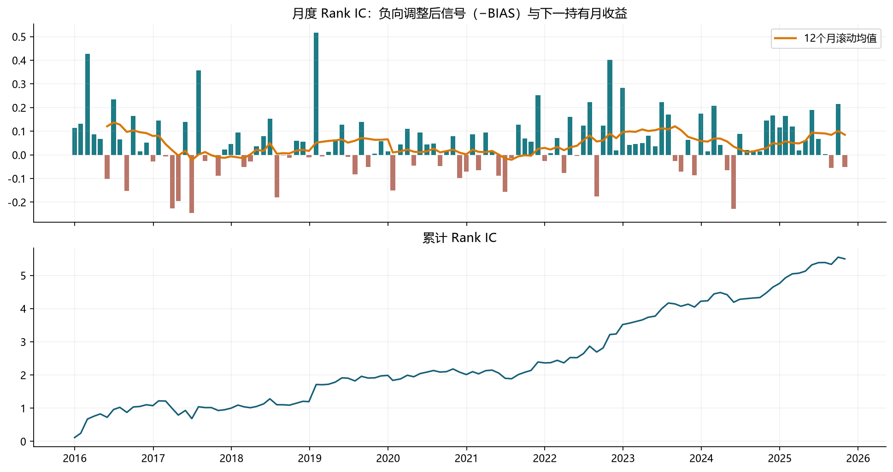
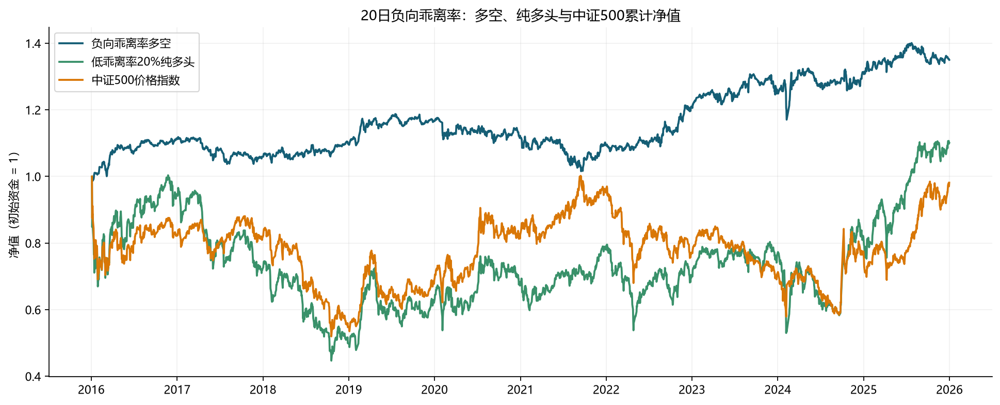
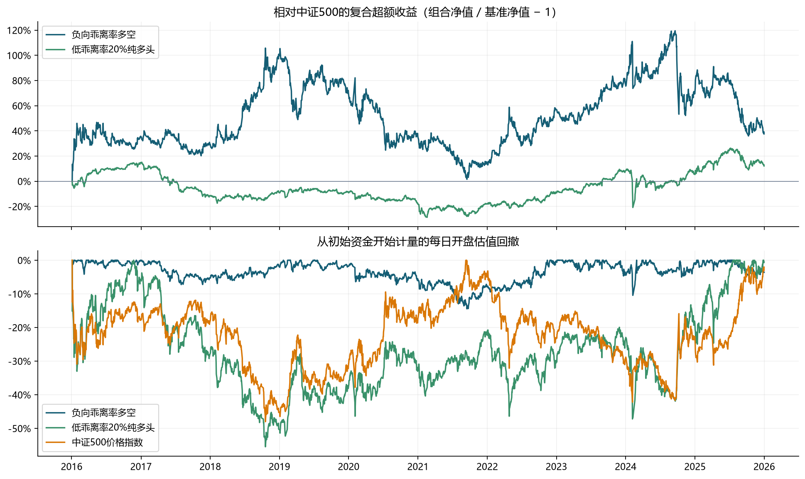
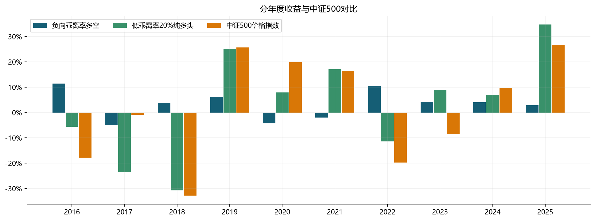
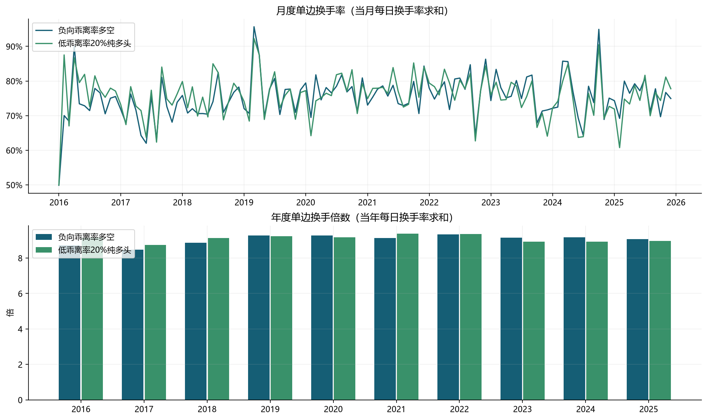

# factor-test

基于 **Polars LazyFrame** 的横截面因子研究与组合回测框架。覆盖因子接口、远期收益、IC / Rank IC、
分层诊断、目标权重生成和逐日账户核算，适合研究因子的预测能力，并检验其在**交易费用、
整数股和停牌**约束下的组合表现。

## 优势与特点

- **账户级回测，关注扣费后收益**：逐日维护现金和实际股数，将佣金、印花税、滑点、
  整数股与停牌约束纳入核算。净值、持仓、成交及未成交原因均有记录，便于追溯收益来源与执行差异。
- **从因子预测力到组合表现的综合验证**：先通过 IC / Rank IC、分层收益和信号稳定性
  检验因子，再比较多空、纯多头及不同调仓周期的账户表现。研究用远期收益与账户执行独立，
  避免将重叠持有期收益直接累计为净值。
- **Polars 原生，便于批量研究与复用**：以 `LazyFrame` 串联因子计算、远期收益和分层诊断，
  可利用 Parquet 惰性扫描与查询优化。自定义因子通过统一的 `compute()` 接口接入，
  可沿用已有分析和回测流程。

## 模块介绍

| 模块 | 职责与主要接口 |
| --- | --- |
| [`factor.py`](./src/factor_test/factor.py) | 定义抽象接口 `BaseFactor`，约定 `compute(pl.LazyFrame) -> pl.LazyFrame`；具体因子负责说明输入列，并返回 `date, symbol, factor`。 |
| [`analyzer.py`](./src/factor_test/analyzer.py) | 统一分析入口：`compute_returns`、`daily_information_coefficient`、`information_coefficient`、`factor_weights`、`portfolio_returns`，并导出诊断与账户接口。 |
| [`diagnostics.py`](./src/factor_test/diagnostics.py) | 分位分组、分组收益及汇总、首尾组价差、单调性、分位组成员换手、因子排名自相关。 |
| [`portfolio.py`](./src/factor_test/portfolio.py) | `backtest_portfolio` 顺序执行目标权重；`BacktestResult` 保存账户与流水；`portfolio_metrics` 汇总绩效，并可传入基准计算相对指标。 |
| [`_utils.py`](./src/factor_test/_utils.py) | 内部共用的持有周期校验、唯一键校验与已有日期排序。 |

## 输入数据约定

输入采用长表，每行对应一个日期和一只股票，使用 `Polars LazyFrame`：

| 数据 | 必需列 | 说明 |
| --- | --- | --- |
| 因子信号 `signals` | `date, symbol, factor` | 因子越大越倾向做多；负向因子可先取负。无效观测使用 `null`。 |
| 行情 `prices` | `date, symbol, open` | 默认使用 `open` 成交和估值，也可通过 `price_col` 指定其他价格列；稀疏信号需另传完整行情。 |
| 目标权重 `weights` | `date, symbol, weight` | 直接调用 `backtest_portfolio` 时使用；正数做多、负数做空，每个信号日总绝对权重不得超过 1。 |
| 基准（可选） | `date, benchmark_return` | 传给 `portfolio_metrics`，须覆盖账户全部日期，收益与账户估值区间保持一致。 |

`(date, symbol)` 必须非空且唯一，信号日期必须包含在行情中，两表键类型须一致或兼容。
建议日期使用 `pl.Date` / `pl.Datetime`，月度调仓要求这两种日期类型。
日期序列取输入行情已有日期的并集并排序，不补充整体缺失的交易日，也不跳过个股缺价日。
具体因子的历史窗口、交易日对齐、复权口径和股票池筛选由调用方准备。

## 基本用法

以下示例读取调用方准备的两张 Parquet 长表。

```python
import polars as pl

from factor_test.analyzer import (
    compute_returns,
    daily_information_coefficient,
    information_coefficient,
    mean_return_by_quantile,
    portfolio_metrics,
    portfolio_returns,
)

signals = pl.scan_parquet("signals.parquet")  # date, symbol, factor
prices = pl.scan_parquet("prices.parquet")    # date, symbol, open
horizons = (1, 5, 20)

# 因子研究：t 日信号，下一交易日开盘进入，再持有 h 个交易区间。
prepared = compute_returns(
    signals, prices=prices, horizons=horizons, entry_lag=1,
)
daily_ic = daily_information_coefficient(prepared, horizons=horizons)
ic_summary = information_coefficient(daily_ic).collect()
group_returns = mean_return_by_quantile(
    prepared, horizons=horizons, quantiles=5,
).collect()

# 账户回测：独立使用信号与行情，每五个交易日调仓，做多因子最高的 20%。
result = portfolio_returns(
    signals,
    prices,
    rebalance_every=5,
    entry_lag=1,
    weight_method="quantile",
    quantile_pct=0.2,
    long_short=False,
    initial_value=1_000_000,
    commission_rate=0.0003,
    slippage_rate=0.0002,
    sell_tax_rate=0.0,
)
metrics = portfolio_metrics(result)
nav = result.daily.select("date", "net_return", "nav", "drawdown")
```

`portfolio_returns` 返回 `BacktestResult`，各表均为 `pl.DataFrame`：

| 属性 | 内容 |
| --- | --- |
| `daily` | 每日现金、持仓市值、毛 / 净收益、净值、回撤、费用与成交金额换手率。 |
| `positions` | 每日股数、估值、实际权重、停牌及价格陈旧状态等持仓快照；可用 `record_positions=False` 关闭。 |
| `trades` | 实际成交的股数差额、金额与各项交易费用。 |
| `unfilled_orders` | 未成交订单、原因及被跳过的信号。 |

`portfolio_metrics` 提供总收益、年化收益 / 波动、Sharpe、最大回撤、成本及换手汇总；
传入基准后还提供超额、跟踪误差、信息比率、alpha / beta。

## Example：A股20日负向乖离率

以下为使用本仓库 `src` 框架得到的回测展示，比较负向乖离率多空组合、纯多头组合与中证500。
数据准备、运行方式、报告文件及数据局限详见 [`example/README.md`](./example/README.md)。

### 回测概况

回测区间：2016-01-04 至 2025-12-31，共2,430个交易日。
AKShare 1.19.3；后复权行情；月度调仓；开盘到开盘估值。

### 因子预测力与IC指标

原始因子为20日乖离率：`BIAS = 后复权收盘价 / 最近20个交易日后复权收盘价的简单均值 − 1`，均价包含当日，策略使用负向因子 `-BIAS`。

#### IC统计

| 指标 | BIAS IC | BIAS Rank IC |
| --- | --- | --- |
| 均值 | -0.0407 | -0.0462 |
| 标准差 | 0.1120 | 0.1264 |
| 月度ICIR | -0.3632 | -0.3656 |
| 年化ICIR（√12） | -1.2581 | -1.2664 |
| 正值比例 | 31.09% | 32.77% |
| t值 | -3.9617 | -3.9880 |
| 双侧p值 | 0.0001278 | 0.000116 |
| 偏度 | -0.1856 | -0.6287 |
| 峰度 | 1.2661 | 1.9154 |

#### 月度Rank IC表现



### 组合绩效与中证500比较

| 指标 | 负向乖离率多空 | 低乖离率20%纯多头 | 中证500 |
| --- | --- | --- | --- |
| 累计收益 | 35.03% | 10.07% | -1.86% |
| 年化收益 | 3.16% | 1.00% | -0.19% |
| 年化波动 | 7.38% | 27.41% | 24.04% |
| Sharpe | 0.459 | 0.174 | 0.112 |
| 最大回撤 | -14.46% | -55.47% | -48.02% |
| 复合超额 | 37.59% | 12.16% | -0.00% |
| 年化复合超额 | 3.36% | 1.20% | -0.00% |
| 日均单边换手率 | 3.72% | 3.74% | 0.00% |

#### 累计净值



#### 超额收益与回撤



### 年度收益



| 年份 | 负向乖离率多空 | 低乖离率20%纯多头 | 中证500 | 多空年度收益差 | 多空年度复合超额 | 纯多头年度收益差 | 纯多头年度复合超额 |
| --- | --- | --- | --- | --- | --- | --- | --- |
| 2016 | 11.48% | -5.64% | -17.86% | 29.34% | 35.71% | 12.21% | 14.87% |
| 2017 | -4.97% | -23.63% | -0.87% | -4.11% | -4.14% | -22.76% | -22.96% |
| 2018 | 3.79% | -30.70% | -32.77% | 36.56% | 54.38% | 2.08% | 3.09% |
| 2019 | 6.16% | 25.24% | 25.69% | -19.53% | -15.54% | -0.45% | -0.36% |
| 2020 | -4.33% | 7.89% | 19.91% | -24.24% | -20.21% | -12.01% | -10.02% |
| 2021 | -1.96% | 17.08% | 16.52% | -18.48% | -15.86% | 0.56% | 0.48% |
| 2022 | 10.56% | -11.37% | -19.75% | 30.31% | 37.76% | 8.38% | 10.44% |
| 2023 | 4.22% | 8.97% | -8.48% | 12.70% | 13.88% | 17.45% | 19.06% |
| 2024 | 4.12% | 7.02% | 9.76% | -5.65% | -5.15% | -2.75% | -2.50% |
| 2025 | 2.82% | 34.80% | 26.63% | -23.81% | -18.80% | 8.17% | 6.45% |

### 策略与执行口径

- 原始乖离率：`BIAS(t) = C(t) / mean(C(t−19), …, C(t)) − 1`，`C`为后复权收盘价。
  简单均价覆盖含信号日在内的最近20个共同交易日；停牌或缺价沿用已知的最近有效收盘价，不向未来填充。
- 按负向因子处理，传给框架的策略因子为 `factor = -BIAS`。
- 调用 `src/factor_test/analyzer.py` 的 `portfolio_returns`，设置 `weight_method="quantile"`、
  `quantile_pct=0.2`。两种策略使用相同信号、行情、日期及费率，各自独立运行。
- 多空组合设置 `long_short=True`：做多原始乖离率最低的20%股票，做空最高的20%股票，目标多空各50%，每侧内部等权。
- 纯多头组合设置 `long_short=False`：仅做多原始乖离率最低的20%股票，目标100%资金等权配置；20%指选股比例。
  选股使用框架的平均排名，不按代码拆分并列值。
- 月末收盘形成信号，下一交易日开盘调仓，使用框架 `rebalance_every="monthly"`、`entry_lag=1`。
  持有期间股数固定，成交、现金、整数股、费用、停牌与缺价均由 `src/factor_test/portfolio.py` 核算。
- 每个信号时点剔除上市不足60个交易日的股票；均价须完整20日A股价格历史，不使用上市前新三板报价补足历史。
- 每种策略初始资金100,000,000元；佣金 `commission_rate=0.0003`（买卖双向），
  印花税 `sell_tax_rate=0.001`（仅卖出方向），滑点 `slippage_rate=0.0`。
  多空组合融券年化费率0.00%；纯多头不收取融券费用。
- 中证500使用000905价格指数，首日开盘买入，基准与组合均按每日开盘估值。
- 绩效通过框架 `portfolio_metrics` 计算。年化按252日，无风险利率0，现金不计息；样本末端保留未到期持仓。

### 交易费用

每种策略初始资金100,000,000元；佣金 `commission_rate=0.0003`（买卖双向），
  印花税 `sell_tax_rate=0.001`（仅卖出方向），滑点 `slippage_rate=0.0`。
  多空组合融券年化费率0.00%；纯多头不收取融券费用。

| 组合 | 成交总额（元） | 佣金（元） | 卖出印花税（元） | 费用合计（元） |
| --- | --- | --- | --- | --- |
| 负向乖离率多空 | 21,050,388,654.70 | 6,315,116.60 | 10,546,859.08 | 16,861,975.68 |
| 低乖离率20%纯多头 | 13,351,985,753.84 | 4,005,595.73 | 6,631,329.94 | 10,636,925.66 |

费用直接汇总框架每日账户；卖出印花税包括卖空开仓，买入平空不征收卖出税。

### 换手率

| 指标 | 负向乖离率多空 | 低乖离率20%纯多头 |
| --- | --- | --- |
| 交易日数 | 2430 | 2430 |
| 有成交日数 | 120 | 120 |
| 日均单边换手率 | 3.72% | 3.74% |
| 有成交日平均单边换手率 | 75.41% | 75.78% |
| 年化单边换手倍数 | 9.38倍 | 9.43倍 |


